<div align="center">

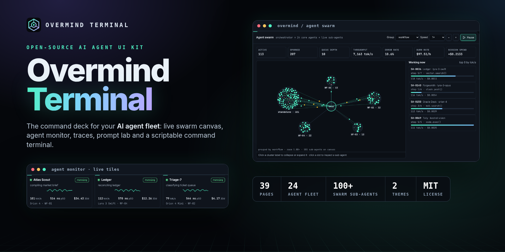

# Overmind Terminal

**A futuristic, open-source command terminal and dashboard UI kit for building, running and managing AI agents.**

Vanilla HTML, CSS and JavaScript. No build step, no dependencies. Open `index.html` and go.

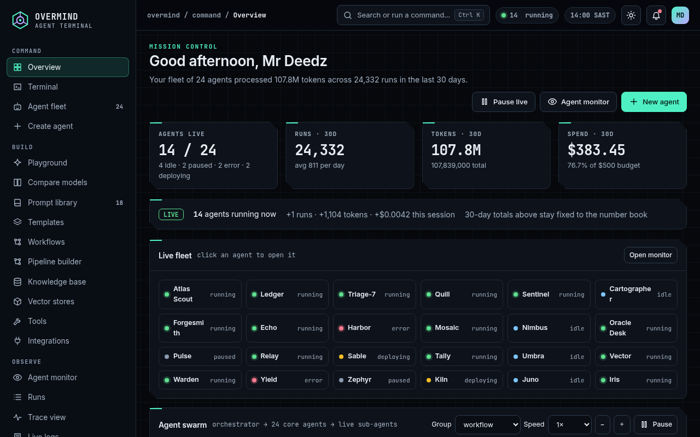

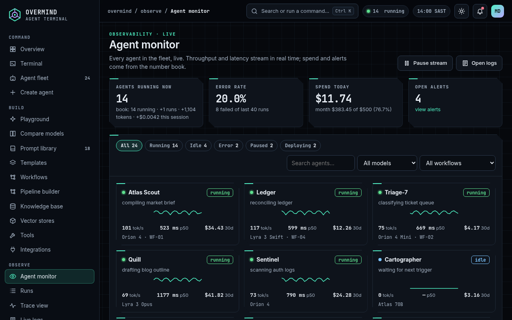

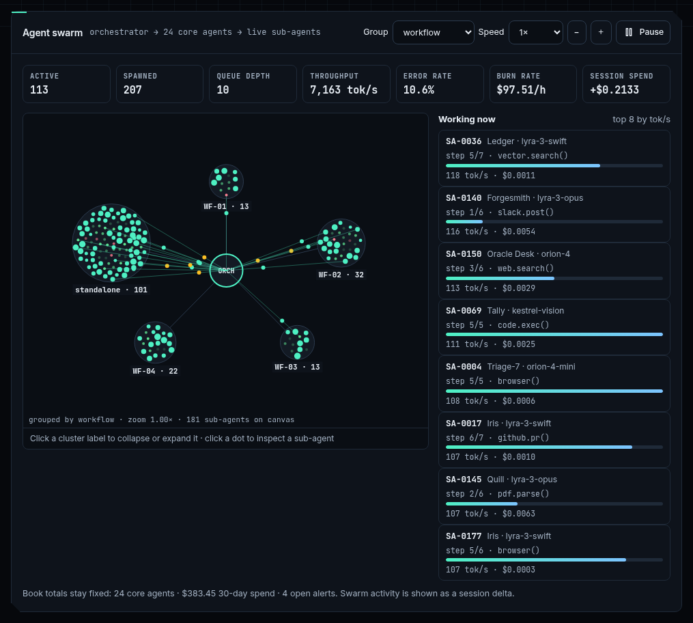

[Features](#features) · [Pages](#pages) · [Quick start](#quick-start) · [Theming](#customising-tokens-and-theming) · [Structure](#folder-structure) · [License](#license)

</div>

---

## Features

- **Working fake shell.** Multi-tab sessions, command history (↑/↓), Tab autocomplete, slash commands (`/agents`, `/run`, `/deploy`, `/logs`, `/models`, `/status`, `/cost`, `/help`) and streamed responses with a typing effect.
- **Agent fleet.** 24 demo agents in grid or list view, with status filters, search, a model filter and empty states.
- **Agent detail.** Config, a line-numbered system-prompt editor, tool toggles, memory, run history and a live log stream.
- **Create-agent wizard.** Five steps: identity, model, tools, knowledge and review, then deploy.
- **Prompt lab.** A playground with model picker and sliders (temperature, top-p, max tokens, presence), plus side-by-side model comparison.
- **Pipeline builder.** An SVG node graph with draggable nodes and an inspector.
- **Observability.** Runs, a trace waterfall, a live log stream with level filters and grep, evaluations, schedules and alerts.
- **Usage and cost analytics.** Every chart is labelled, with axes, values and legends, and every figure reconciles to one number book.
- **Platform.** Models, providers, masked API keys and secrets, tools, integrations, vector stores, billing, team, roles, audit log, notifications and settings.
- **Live overview.** The dashboard has a live activity feed, a live status strip for all 24 agents, a real-time tokens-per-minute chart, pause/resume, and click-through to agent detail or the monitor. It shares one simulation engine (`assets/js/live.js`) with the monitor, so their numbers agree.
- **Agent swarm.** A canvas view where the orchestrator spawns 100+ short-lived sub-agents. It shows animated handoff lines, clusters by workflow, model or status, zoom and collapse, a recycled "working now" list (step progress, tool call, tok/s, cost), swarm KPIs (active, spawned, queue depth, throughput, error rate, burn rate), speed control and a detail drawer.
- **Live agent monitor.** All 24 agents as live tiles with status, current task, tokens/s, latency, cost and sparklines. It has a scrolling event stream, pause/resume, filters by status, model and workflow, search, and a detail drawer with the latest trace, recent runs and pause/restart/kill actions.
- **Instant in-app navigation.** Links fetch the target page and swap only the main content, with a terminal-style `$ loading <page>…` loader. History is handled with `history.pushState`, so back, forward and deep links work. The sidebar keeps its scroll position, and page timers and listeners are cleaned up on every swap. Opened from `file://`, links fall back to normal page loads.
- **Command palette.** Press `Ctrl/⌘ + K` to jump to any page, agent or action.
- **Dark-first, with a light theme.** Both themes meet WCAG AA text contrast (4.5:1 or better).
- **Responsive.** Tested at 390, 768 and 1280 px. Tablets and phones get a bottom dock and a "More" sheet with every page. Tables scroll inside their own frames.
- **One number book.** `assets/js/data.js` drives every count, cost and total, so the pages always agree.

## Pages

39 pages in total.

| Area | Pages |
| --- | --- |
| Command | `index` overview, `terminal`, `agents`, `agent-detail`, `create-agent` |
| Build | `playground`, `compare`, `prompts`, `templates`, `workflows`, `workflow-builder`, `knowledge`, `vector-stores`, `tools`, `integrations` |
| Observe | `monitor` (live), `runs`, `trace`, `logs`, `evals`, `schedules`, `alerts`, `usage` |
| Platform | `models`, `providers`, `keys`, `billing`, `team`, `roles`, `audit`, `notifications`, `settings`, `profile`, `ui-elements` |
| Access | `login`, `signup`, `forgot-password`, `onboarding`, `404` |

| Desktop | Mobile |
| --- | --- |
| 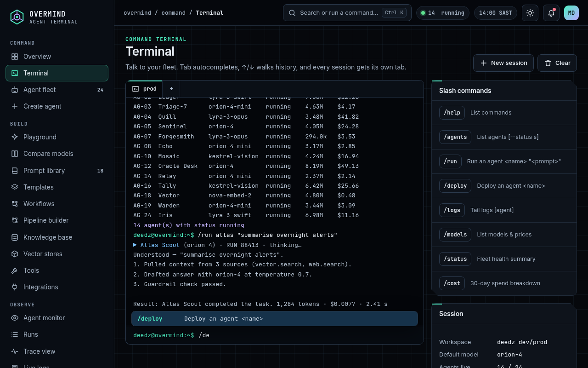 | 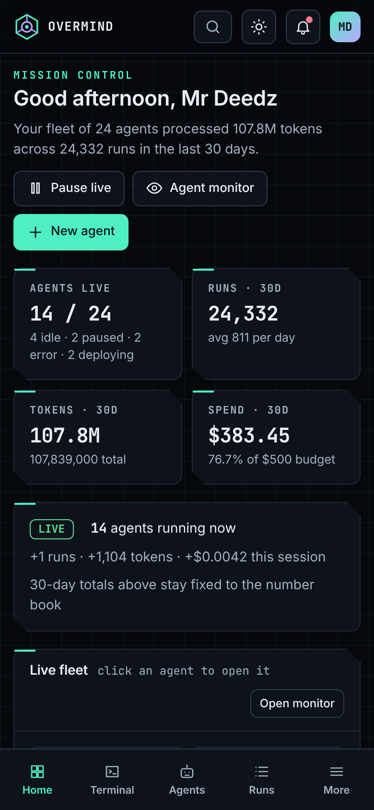 |
| 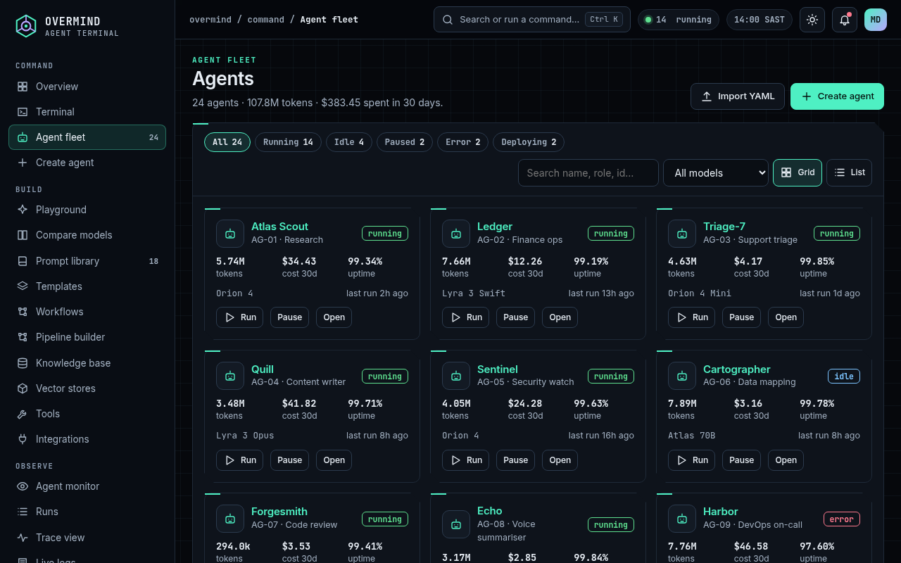 | 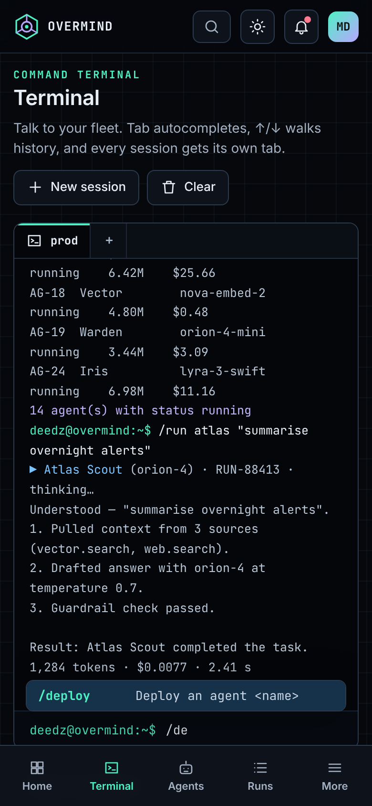 |
| 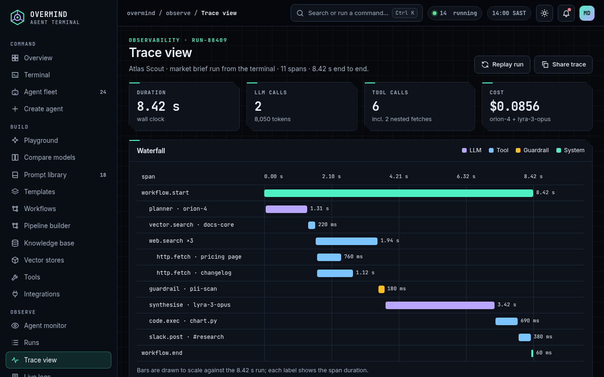 | 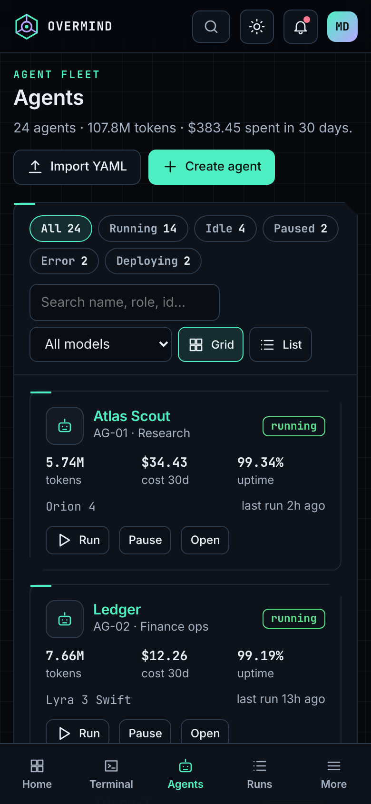 |
| 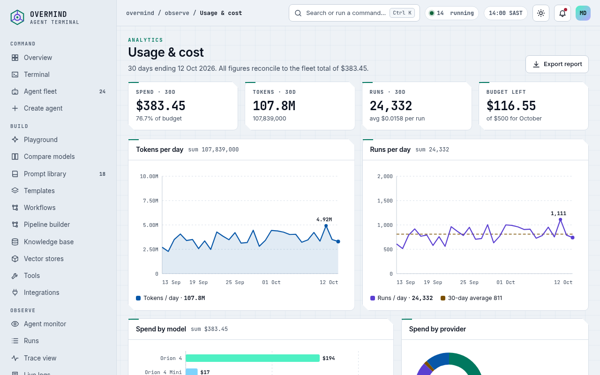 | 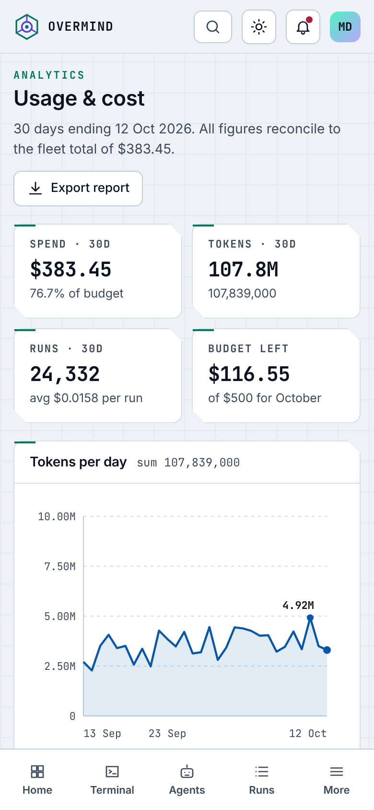 |

## Quick start

```bash
git clone https://github.com/iDeedz/Overmind-Terminal.git
cd Overmind-Terminal
# either open index.html directly in a browser, or serve the folder:
npm run serve        # python3 -m http.server 8080
# or: npx serve .
```

Then open <http://localhost:8080>. Deep links work too, for example `agent-detail.html?id=AG-07`.

## Folder structure

```
overmind-terminal/
├── index.html … 404.html      # 39 thin entry pages (one per screen)
├── assets/
│   ├── css/overmind.css       # design tokens, components, responsive rules
│   ├── js/data.js             # the number book: agents, models, runs, costs…
│   ├── js/app.js              # shell, nav, icons, charts, palette, toasts, theme
│   ├── js/pages-core.js       # Command + Build pages
│   ├── js/pages-ops.js        # Observe, Platform + Access pages
│   ├── js/live.js             # shared live simulation engine
│   ├── js/pages-monitor.js    # live Agent monitor
│   ├── js/pages-swarm.js      # Agent swarm canvas (Overview)
│   └── img/logo.svg
├── docs/screenshots/          # README images + social preview
├── tools/make-pages.py        # optional: regenerates the HTML entry files
└── README.md, LICENSE, CHANGELOG.md, CONTRIBUTING.md, CODE_OF_CONDUCT.md
```

Each HTML file only sets `<body data-page="…">`. `app.js` draws the shell and calls `PAGES[page].render()`.

## Customising tokens and theming

All colours, radii and sizes are CSS custom properties at the top of `assets/css/overmind.css`:

```css
:root {                     /* dark (default) */
  --bg: #06080c; --panel: #0e131b; --text: #e8eef5; --muted: #a3b1c2;
  --accent: #4ef0c3; --violet: #b9a6ff; --amber: #fbbf24; --red: #ff7a8f;
  --rail: 248px; --r: 10px;
}
[data-theme="light"] { --bg: #eef2f6; --accent: #00785f; /* … */ }
```

- **Brand colour:** change `--accent`, plus `--accent-ink` for the text on accent buttons, in both theme blocks. Keep text contrast at 4.5:1 or better.
- **Default theme:** the toggle saves to `localStorage('om-theme')`. Change the fallback in `app.js` (`applyTheme(saved || 'dark')`).
- **Data:** edit the arrays in `assets/js/data.js`. Totals, charts and KPIs are derived from them, so they stay consistent.
- **New page:** add an entry to `PAGES` in `tools/make-pages.py`, add it to `NAV` in `app.js`, and write `PAGES['my-page'] = { render() { … } }`.
- **Fonts:** the kit uses system stacks with optional *Inter* and *JetBrains Mono*. Add them with a `<link>` if you want them.

## Browser support

The latest two versions of Chrome, Edge, Firefox and Safari, on desktop, iOS and Android. No polyfills are needed. The kit uses CSS custom properties, CSS grid, `backdrop-filter` (it degrades gracefully without it) and ES5-compatible JavaScript.

## Credits

- Design and code: **Mr Deedz / Deedz Dev**.
- Icons: hand-drawn inline SVG, 24 px stroke set, included in `app.js`.
- All agents, providers, models, people and numbers are fictional demo data.

## Contributing

PRs are welcome. Read [CONTRIBUTING.md](CONTRIBUTING.md) and the [Code of Conduct](CODE_OF_CONDUCT.md) first.

## License

[MIT](LICENSE) © 2026 Mr Deedz / Deedz Dev
